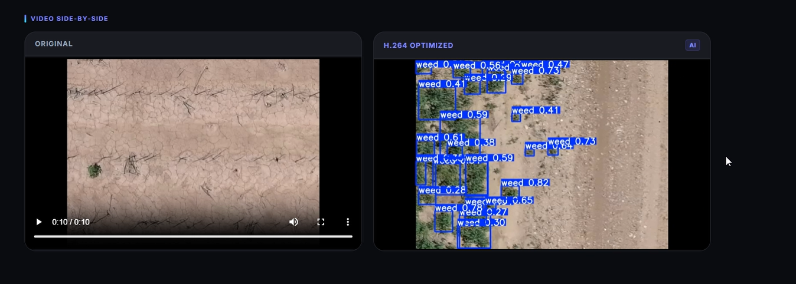

# 🌱 CottonVision — UAV Cotton & Weed Detection System

**AI-powered system that detects weeds in cotton fields from drone aerial footage and orthomosaics — enabling targeted precision herbicide spraying and reducing chemical waste.**

[](https://youtu.be/bO3l2jyvdKA)
[](https://github.com/ultralytics/ultralytics)
[](https://docs.openvino.ai/)
[](https://drive.google.com/drive/folders/1rnBnCmXL_B9jeZK325pCOdOYbs2EzgAg?usp=sharing)
[](./LICENSE)

---

## ⚡ Quick Start (Single Command)

You can launch the complete application (Flask inference backend + interactive CottonVision web application) with **a single command**:

### Linux / macOS / WSL / Git Bash
```bash
bash deployment-script.sh
```
*(Or `./deployment-script.sh`)*

### Windows (Command Prompt / PowerShell)
```cmd
run.bat
```
*Or directly with Python:*
```powershell
python -m backend.server.server
```

Once started, open your web browser to:
👉 **[http://localhost:5000](http://localhost:5000)**

*(If Node.js and npm are installed in your environment, `npm run dev` inside `frontend/` will also run the Vite frontend proxy on `http://localhost:3000`)*.

---

## 📺 Visual Demonstration

### Full Video Walkthrough
[](https://youtu.be/bO3l2jyvdKA)

### Live Inference & Side-by-Side Validation


### Detection Results (Raw UAV Stream vs YOLOv8 Annotated Stream)


---

## 🌟 Key Features

* **Complete 10-Section Landing Page & Interactive Workbench**: Built with a single `Host Grotesk` typography system on a clean, light `#ffffff` ground with `#2e5bff` action pills.
* **Dual-Path UAV Media Engine**: Dedicated high-speed inference path for single aerial orthomosaic images (`< 380ms` latency) alongside an asynchronous background processing queue for long 4K flight videos.
* **Temporal-Locked Frame Skipping**: Eliminates fast-forward video distortion by dynamically recalculating frame rates:
  $$\text{Output FPS} = \frac{\text{Source FPS}}{\text{Frame Interval}}$$
  Selectable intervals (`1x`, `2x`, `5x`, `10x`, `15x`) keep output video duration locked to real-world flight seconds.
* **Browser-Native H.264 Playback**: Transcodes video using the `avc1` codec and repositions container metadata (`moov atom`) to the beginning of the file for instant HTML5 streaming without black-screen errors.
* **One-Click YOLO Dataset Export**: Packages all extracted frames and normalized YOLOv8 labels (`.txt`) into a structured `.zip` ready for model re-training or autonomous sprayer guidance.
* **Interactive Flight Presets**: Pre-loaded with aerial test flights for immediate evaluation without requiring manual video uploads.
* **Hardware-Agnostic Acceleration**: Optimized for both CPUs and Intel Arc discrete/integrated GPUs using Intel OpenVINO.

---

## 📊 Model Performance

Trained on high-resolution UAV aerial datasets under diverse lighting and growth conditions:

| Metric | Weed Detection | Cotton Crop Detection |
| :--- | :--- | :--- |
| **mAP@50** | **76.0%** | **93.8%** |
| **Precision** | **74.9%** | **91.2%** |
| **Recall** | **66.6%** | **89.5%** |
| **Inference Engine** | YOLOv8 + OpenVINO | YOLOv8 + OpenVINO |

---

## 📦 UAV Dataset Download

The custom annotated UAV aerial dataset used to train the YOLOv8 model is publicly available. You can download raw drone flight imagery and paired YOLO annotations:

📥 **[Download Cotton-Weed UAV Dataset (Google Drive) →](https://drive.google.com/drive/folders/1rnBnCmXL_B9jeZK325pCOdOYbs2EzgAg?usp=sharing)**

---

## 🧱 Technology Stack

* **Frontend**: React 19, Vite, Host Grotesk Web Fonts, Vanilla JS / HTML5, CSS3 design tokens.
* **Backend**: Python 3.10+, Flask, Flask-CORS, Werkzeug.
* **Computer Vision & ML**: YOLOv8 (Ultralytics), PyTorch, Intel OpenVINO runtime, OpenCV (cv2).
* **Deployment & Tooling**: Single-command bash (`deployment-script.sh`), Windows batch (`run.bat`), Docker & Docker Compose.

---

## 📁 Project Directory Structure

```text
Cotton-Weed-Prediction-Model/
 ├── index.html                   # Unified standalone web application & landing page
 ├── deployment-script.sh         # Single-command launch script (Linux/macOS/WSL/Git Bash)
 ├── run.bat                      # Single-command launch script (Windows)
 ├── start_backend.sh             # Dedicated backend start script
 ├── model.pt                     # Trained YOLOv8 model weights
 ├── requirements.txt             # Python backend dependencies
 ├── docker-compose.yml           # Multi-container deployment configuration
 ├── assets/                      # Demo GIFs, architecture charts, before/after graphics
 ├── backend/
 │    ├── server/                 # Flask REST API and static route handlers (server.py)
 │    ├── scripts/                # Video extraction, YOLO annotation, and conversion scripts
 │    └── utils/                  # Path management and file timestamp generators
 ├── frontend/
 │    ├── index.html              # Vite entry template with Host Grotesk font
 │    ├── package.json            # Node.js frontend configuration
 │    ├── vite.config.js          # Vite build & reverse-proxy configuration
 │    ├── public/samples/         # Pre-loaded aerial drone test imagery and tiles
 │    └── src/
 │         ├── App.jsx            # 10-section landing page & live workbench component
 │         ├── index.css          # Design system tokens and responsive stylesheet
 │         └── main.jsx           # React DOM mounting
 ├── samples/                     # Standalone sample aerial flight footage & tiles
 ├── training-the-model/          # Jupyter notebooks, configs, and training curves
 └── utils/                       # Dataset visualizers and statistics scripts
```

---

## 🔌 API Endpoints Reference

The backend provides a comprehensive REST API on port `5000`:

| Method | Endpoint | Description |
| :--- | :--- | :--- |
| `GET` | `/` | Serves the full CottonVision landing page and workbench |
| `POST` | `/api/upload` | Uploads drone flight image or video file |
| `POST` | `/api/process-image` | Executes single-shot YOLOv8 inference and generates label `.txt` |
| `POST` | `/api/process` | Queues asynchronous multi-frame video inference pipeline |
| `GET` | `/api/status/<job_id>` | Returns live processing progress, percent, and output URLs |
| `GET` | `/api/media/<path>` | Streams raw and annotated media files |
| `GET` | `/api/download/dataset/<job_id>` | Packages and streams structured YOLO dataset archive (`.zip`) |

---

## 🛠️ Detailed Documentation

* **[DEPLOYMENT.md](./DEPLOYMENT.md)** — Step-by-step manual setup, virtual environments, and WSL guidance.
* **[Challenges_and_Solutions.md](./Challenges_and_Solutions.md)** — Engineering report resolving video durations, browser H.264 codecs, and state management.
* **[Final_Report.pdf](./Final_Report.pdf)** — Comprehensive agronomic and research paper on UAV weed detection.

---

## 📄 License

This project is licensed under the Apache License 2.0. See the [LICENSE](./LICENSE) file for details.
